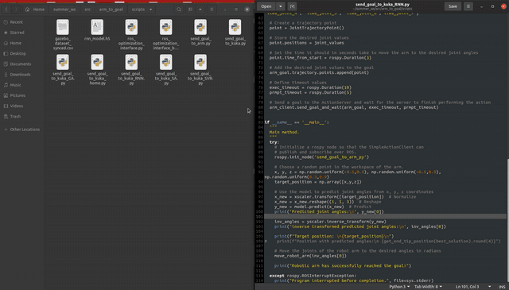
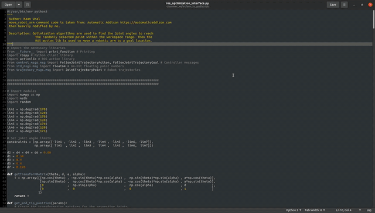

# 7-DoF Robotic Arm Inverse Kinematics with Neural Networks

This project uses machine learning and optimisation algorithms to solve inverse kinematics (IK) for the KUKA LBR iiwa 7 R800, a 7-DoF arm. Given a target end-effector position (x, y, z), it finds the seven joint angles that reach it. The project runs in ROS Noetic and Gazebo. It was a master's course project at the University of Salford in 2024.

The full write-up is in the paper [*Enhancing 7-DOF Robotic Arm Inverse Kinematics: A Machine Learning and Optimization Approach*](Paper%20-%20Enhancing%207DoF%20Inverse%20Kinematics.pdf) (K. Ural, University of Salford, 2024).

## Demonstrations

The previews run at 8× speed. Click one to watch the full video on YouTube.

**Pre-trained RNN in the loop.** The RNN predicts joint angles for a random target, and the arm moves there in Gazebo.

[](https://www.youtube.com/watch?v=oNOpLSOW1oE)

**Optimisation interface.** You choose an algorithm, it solves for a random target, and the arm moves to the solution.

[](https://www.youtube.com/watch?v=qeP7brktsMY)

## Approach

### Robot and kinematics

The arm is modelled with the Denavit–Hartenberg convention. The parameters below were checked against the arm's movement in Gazebo, and the forward kinematics used by the optimisers is built from them.

| Joint | θ | d (m) | a | α (°) | Limit |
|---|---|---|---|---|---|
| 1 | q1 | 0.34 | 0 | −90 | ±170° |
| 2 | q2 | 0 | 0 | 90 | ±120° |
| 3 | q3 | 0.4 | 0 | 90 | ±170° |
| 4 | q4 | 0 | 0 | −90 | ±120° |
| 5 | q5 | 0.4 | 0 | −90 | ±170° |
| 6 | q6 | 0 | 0 | 90 | ±120° |
| 7 | q7 | 0.126 | 0 | 0 | ±175° |

### Dataset

MoveIt drove the simulated iiwa 7 through sequential and random movements in Gazebo, and rosbag recorded two streams:

- **Joint angles** from the iiwa controller (`joint_states`, 100 Hz)
- **End-effector position**, which is link 7's position extracted from Gazebo's `link_states` (1000 Hz)

The two streams were synchronised on their timestamps with pandas. The result is [`gazebo_dataset_synced.csv`](src/arm_to_goal/scripts/gazebo_dataset_synced.csv), with about 96,000 rows of `x, y, z, theta0 … theta6`. The data was split 70% for training, 15% for validation and 15% for testing, and scaled with `StandardScaler` or `MinMaxScaler` depending on the model. [`src/notebooks/gazebo_extract_xyz&angles.ipynb`](src/notebooks/gazebo_extract_xyz&angles.ipynb) does the extraction and synchronisation.

### Learned models: position in, joint angles out

| Model | Configuration |
|---|---|
| Feedforward NN (ReLU) | Dense 300-300-300-128-32 with ReLU and a linear output; SGD (lr 0.017, momentum 0.9); MSE loss |
| Feedforward NN (tanh) | The same network with tanh activations, to compare activation functions |
| Recurrent NN | SimpleRNN with 128 units (ReLU), then Dense 128 (ReLU), Dense 32 (linear) and a 7-unit output; Adam; MSE loss; 200 epochs |
| LSTM | The same architecture with LSTM cells; SGD (lr 0.01, momentum 0.9); 60 epochs |
| Random forest | 20 trees, out-of-bag scoring |
| Decision tree | `max_depth=18`, `min_samples_leaf=15` |
| SVR | RBF kernel, C = 100, ε = 0.1, wrapped in `MultiOutputRegressor` (one SVR per joint) |

### Optimisation: search joint space for the target

Each optimiser minimises the Euclidean distance between the target and the forward-kinematics position of a candidate set of joint angles, with each joint kept within its limits.

| Algorithm | Configuration |
|---|---|
| Genetic algorithm | Population 80, 1200 generations; selection, crossover and mutation |
| Differential evolution | Population 90, 1000 generations |
| Particle swarm | Global-best PSO, using [PySwarms](https://github.com/ljvmiranda921/pyswarms) |
| Gradient descent | Gradient from finite differences, with a fixed learning rate |
| Simulated annealing | Cooling schedule, with Metropolis acceptance P = e^(−ΔE/T) |

These are the paper's settings. In `ros_optimization_interface.py`, differential evolution uses a population of 100 for 600 generations, and PSO uses c1 = c2 = 1.5 and w = 0.5.

## Results

These are the learned models' metrics on the test set, as reported in Table II of the paper.

| Model | MAE | MSE | RMSE | R² | Explained variance |
|---|---|---|---|---|---|
| FNN (ReLU) | 0.1621 | 0.0136 | 0.1166 | 0.8833 | 0.8842 |
| FNN (tanh) | 0.1629 | 0.0148 | 0.1216 | 0.8794 | 0.8798 |
| RNN | 0.0406 | 0.0048 | <0.001 | 0.764 | 0.6705 |
| LSTM | 0.1101 | 0.0181 | 0.1345 | 0.2909 | 0.4327 |
| Random forest | **0.0045** | 0.0049 | <0.001 | **0.9991** | **0.9993** |
| Decision tree | 0.0881 | 0.1315 | 0.3493 | 0.9896 | 0.9687 |
| SVR | 0.5140 | 0.9440 | 0.9500 | 0.9250 | 0.733 |

The random forest fits best overall. The RNN has the second-lowest MAE, and the LSTM explains the least variance.

The paper compares the optimisers by their convergence curves. Gradient descent and differential evolution converge smoothly. PSO drops quickly and then levels off. Simulated annealing improves sharply at high temperature and settles as it cools. The genetic algorithm's best score swings widely, which suggests it is sensitive to its initial population and settings.

## Repository layout

```
Paper - Enhancing 7DoF Inverse Kinematics.pdf
docs/                       rostopic commands for moving the arms by hand; demo previews in docs/media/
src/                        catkin workspace src/ (ROS Noetic)
  arm_to_goal/              ROS IK scripts, the pre-trained RNN and SVR, and the dataset
  iiwa_stack/               KUKA iiwa description, Gazebo, control and MoveIt packages (from IFL-CAMP/iiwa_stack)
  mob_man_7/                mobile manipulator: iiwa 7 on a mobile base
  mobile_manipulator_body/  mobile base description
  notebooks/                dataset preparation, and a training/evaluation notebook for every model and optimiser
  .rosinstall               upstream MoveIt and related packages, pinned to the commits used
```

### Notebooks in `src/notebooks/`

The models and optimisers were developed and evaluated in these notebooks, and the outputs are saved in them.

| Notebook | Contents |
|---|---|
| `gazebo_extract_xyz&angles.ipynb` | Extracts link 7's position and the joint angles from the recordings and syncs them |
| `merge_several_datasets.ipynb` | Concatenates datasets from several recordings |
| `KUKA_FNN.ipynb` | Feedforward network (ReLU and tanh) |
| `KUKA_RNN.ipynb`, `KUKA_RNN_save.ipynb` | Recurrent network; the `_save` version exports the model used by the ROS script |
| `KUKA_LTSM.ipynb` | LSTM |
| `KUKA_RFR.ipynb` | Random forest regression |
| `KUKA_DT.ipynb` | Decision tree regression |
| `KUKA_SVR.ipynb` | SVR; exports `multi_output_svr.joblib` |
| `Kuka_GA.ipynb`, `KUKA_DE.ipynb`, `KUKA_PSO.ipynb`, `KUKA_GD.ipynb`, `KUKA_SA.ipynb` | Genetic algorithm, differential evolution, particle swarm, gradient descent and simulated annealing |
| `KUKA_Arm_OptimizationAlgorithms.ipynb` | All the optimisers in one notebook |

The notebooks load their dataset from the working directory. The RNN and decision tree use `gazebo_dataset_synced.csv`, which is in `src/arm_to_goal/scripts/`. The FNN, LSTM, random forest and SVR were trained on larger merged datasets (`gazebo_full_dataset_synced.csv` and `gazebo_full+_dataset_synced.csv`), which are not in this repository.

### ROS scripts in `src/arm_to_goal/scripts/`

Each script solves for a random target in the workspace and sends the joint angles to the arm through the `FollowJointTrajectory` action.

| Script | Solver |
|---|---|
| `ros_optimization_interface.py` | Menu: simulated annealing, differential evolution, genetic algorithm, PSO or gradient descent; can also send the arm home |
| `send_goal_to_kuka_RNN.py` | The pre-trained RNN (`rnn_model.h5`) |
| `send_goal_to_kuka_SVR.py` | The pre-trained SVR (`multi_output_svr.joblib`) |
| `send_goal_to_kuka_SA.py`, `send_goal_to_kuka_GA.py` | Simulated annealing or the genetic algorithm on its own |
| `send_goal_to_kuka_home.py` | None; it sends the arm to the zero position |

The FNN, LSTM, random forest and decision tree were evaluated offline only and have no ROS script. The raw rosbag recordings (about 700 MB) are not included because they exceed GitHub's file size limit.

## Setup

The workspace was built on Ubuntu 20.04 with ROS Noetic and Gazebo 11.

```bash
mkdir -p ~/ik_ws && cd ~/ik_ws
git clone https://github.com/knnurl/7-DoF-Robotic-Arm-Inverse-Kinematics-with-Neural-Networks.git repo
ln -s repo/src src

# upstream packages (MoveIt, geometric_shapes, srdfdom, ...)
wstool init src src/.rosinstall    # or: vcs import src < src/.rosinstall

rosdep install --from-paths src --ignore-src -r -y
catkin build                       # or catkin_make
source devel/setup.bash

pip3 install numpy pandas scikit-learn==1.2.2 joblib tensorflow keras pyswarms matplotlib
```

`multi_output_svr.joblib` was saved with scikit-learn 1.2.2. Other versions may warn when they load it, or fail to load it.

## Running

Start the iiwa 7 in Gazebo with the position trajectory controller:

```bash
roslaunch iiwa_gazebo iiwa_gazebo.launch model:=iiwa7
```

In a second terminal, run a solver from the `arm_to_goal` package directory. The scripts load the models and the dataset by relative path (`scripts/...`), so they must be started from that directory:

```bash
cd ~/ik_ws/src/arm_to_goal
python3 scripts/ros_optimization_interface.py   # choose an optimisation algorithm
python3 scripts/send_goal_to_kuka_RNN.py        # pre-trained RNN
python3 scripts/send_goal_to_kuka_SVR.py        # pre-trained SVR
```

The goals go to `/iiwa/PositionJointInterface_trajectory_controller/follow_joint_trajectory`. To move the arm by hand with `rostopic pub`, see [docs/arm_control_commands.md](docs/arm_control_commands.md).

## Credits

- Kaan Ural, School of Computing, Science and Engineering, University of Salford, as a master's course project (2024). Supervised by Dr Salem Ameen and Prof Mary He.
- The iiwa model and `iiwa_stack` come from [IFL-CAMP/iiwa_stack](https://github.com/IFL-CAMP/iiwa_stack) (TU Munich; BSD-2-Clause, see `src/iiwa_stack/LICENSE`).
- The `move_robot_arm` action-client code is adapted from [Automatic Addison](https://automaticaddison.com).

## Use of AI

The project was developed in 2024 without AI tools: the ROS scripts, notebooks, trained models, dataset and paper. In 2026 an AI assistant was used to organise this repository and write this README. The only code change it made was the model path in `send_goal_to_kuka_SVR.py`.
